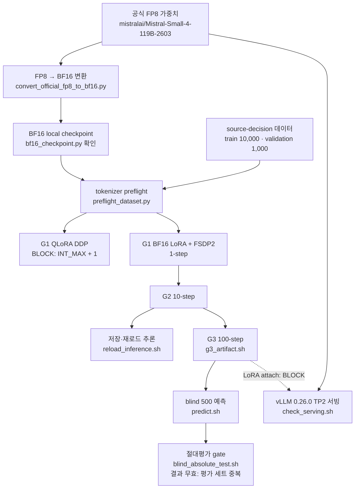

<div align="center">

# AegisLM Mistral Small 4 119B

**B200 2장에서 Mistral Small 4(119B)를 BF16 LoRA + FSDP2로 파인튜닝하고, adapter 저장·재로드와 원본 모델 vLLM 서빙까지 확인한 실험 저장소**

[](pyproject.toml)
[](uv.lock)
[](uv.lock)
[](pyproject.toml)
[](pyproject.toml)
[](serving/vllm/pyproject.toml)
[](https://huggingface.co/mistralai/Mistral-Small-4-119B-2603)
[](https://github.com/Malicious-code-detection-project/AegisLM-Mistral-Small-4-119B/commits/main)

[빠른 시작](#빠른-시작) · [튜토리얼](#튜토리얼-b200-재현-순서) · [구조](#구조) · [결과](#결과) · [동기화 보고서](docs/B200_SYNC_REPORT_20260825.md)

</div>

B200 두 장에서 `mistralai/Mistral-Small-4-119B-2603`을 BF16 LoRA + FSDP2로 파인튜닝하고,
adapter lifecycle·vLLM serving을 검증하는 독립 프로젝트입니다. blind 500건 평가 결과는 평가 세트 중복으로 무효입니다([현재 상태](#현재-상태)).
과제는 C/C++ 소스 함수에 대한 source-decision 판단이며, 모델은
`{"assessment": "present" | "not_observed" | "uncertain"}` 형식의 JSON 한 줄로 답합니다.

이 저장소에는 코드, Axolotl 설정과 dependency lock만 있습니다. 모델 가중치, 데이터셋,
adapter, 평가 산출물과 로그는 들어 있지 않습니다. 따라서 **모든 학습·추론·서빙 단계는
B200급 GPU 2장과 로컬에 준비한 가중치·데이터가 있어야 실행됩니다.** 테스트 파일은 없습니다.

## 하이라이트

- **119B MoE를 GPU 2장에서 LoRA로 학습합니다.** BF16 LoRA + FSDP2(`fsdp_version: 2`)로 attention·shared expert의 Linear 층과 fused MoE expert parameter(`mlp.experts.gate_up_proj`, `mlp.experts.down_proj`)를 함께 학습합니다. vision tower와 router는 제외합니다.
- **공식 FP8 체크포인트를 BF16으로 바꿔 씁니다.** `scripts/convert_official_fp8_to_bf16.py`로 변환하고 `scripts/bf16_checkpoint.py`로 FP8·scale tensor가 남지 않았는지 확인합니다.
- **막힌 경로도 기록합니다.** bitsandbytes QLoRA는 fused expert tensor의 `INT_MAX + 1` 크기 제한으로 BLOCK되었고, 그 설정(`configs/g1-qlora-ddp-1step.yaml`)을 그대로 남겼습니다.
- **단계별 gate로 넓혀 갑니다.** G1 1-step → G2 10-step 저장·재로드 → G3 100-step → blind 500건 절대평가 순서로, 각 단계는 PASS 문자열·로그·SHA-256 목록으로 판정합니다.
- **학습과 서빙 환경을 나눕니다.** 학습(Axolotl·torch cu130)과 서빙(vLLM 0.26.0)은 dependency가 충돌하므로 별도 uv 프로젝트입니다.

## 빠른 시작

> **GPU 필요:** 아래 설치는 B200(sm100)과 CUDA 13 환경을 전제로 합니다. 학습 환경은 cu130 PyTorch 휠을 받고
> `flash-attn`을 `FLASH_ATTN_CUDA_ARCHS=100`으로 소스 빌드하므로([`pyproject.toml`](pyproject.toml)), CPU 전용 머신에서는 설치가 끝나지 않습니다.

```bash
git clone https://github.com/Malicious-code-detection-project/AegisLM-Mistral-Small-4-119B.git
cd AegisLM-Mistral-Small-4-119B

# 학습·평가 환경
uv sync --frozen

# 서빙 환경 (별도 uv 프로젝트)
cd serving/vllm
uv sync --frozen
cd ../..
```

설치 뒤에는 모델 가중치와 데이터를 저장소 기준 상대경로(`model/`, `data/`)에 준비해야 합니다.
순서는 [튜토리얼](#튜토리얼-b200-재현-순서)에 있습니다.

### CPU에서 볼 수 있는 것: 설정 차이

GPU 없이 확인할 수 있는 것은 설정 파일 정도입니다. G2(10-step)와 G3(100-step) 설정은 run ID, step 수,
저장 주기만 다릅니다. LoRA 구성, 학습률, FSDP2 설정, seed는 같습니다.

```bash
diff configs/g2-bf16-lora-fsdp2-10step-20260818-001.yaml \
     configs/g3-bf16-lora-fsdp2-100step-20260819-001.yaml
```

```text
25,26c25,26
< dataset_prepared_path: artifact/mistral-small-4-119b/prepared/g2-bf16-lora-fsdp2-20260818-001
< output_dir: artifact/mistral-small-4-119b/runs/g2-bf16-lora-fsdp2-20260818-001
---
> dataset_prepared_path: artifact/mistral-small-4-119b/prepared/g3-bf16-lora-fsdp2-20260819-001
> output_dir: artifact/mistral-small-4-119b/runs/g3-bf16-lora-fsdp2-20260819-001
59c59
< max_steps: 10
---
> max_steps: 100
104c104
< save_steps: 10
---
> save_steps: 100
```

G3 설정은 [`scripts/step_10_to_100.sh`](scripts/step_10_to_100.sh)가 G2 설정에서 `sed`로 이 세 가지만 바꿔 만든 것입니다.
G3 파일이 이미 있으므로 이 스크립트는 다시 실행하지 않습니다(아래 [알려진 문제](#알려진-문제) 참조).

## 환경

학습과 서빙 dependency가 충돌하므로 두 uv project를 분리합니다.

| 역할 | 위치 | 핵심 runtime |
| --- | --- | --- |
| 학습·평가 | project root | Python 3.12.3, PyTorch 2.12.1+cu130, Axolotl 0.17.0, Transformers 5.9.0 |
| 서빙 | `serving/vllm/` | Python 3.12.3, vLLM 0.26.0 CUDA 13 wheel |

공통 학습 설정(G1·G2·G3 BF16 LoRA)은 다음과 같습니다. 값은 `configs/*.yaml` 기준입니다.

| 항목 | 값 |
| --- | --- |
| base | `model/mistral-small-4-119b-2603-bf16-local` (공식 FP8에서 변환한 BF16) |
| adapter | LoRA r=16, alpha=32, dropout=0.0 |
| sequence | `sequence_len: 2048`, packing 없음, assistant 턴만 학습 |
| optimizer | `adamw_torch_fused`, lr 1e-4, constant, micro batch 1 |
| 분산 | FSDP2, `Mistral4DecoderLayer` 단위 wrap, 2 GPU (`torchrun --nproc-per-node=2`) |
| chat template | tokenizer 기본, `reasoning_effort: "none"` |
| seed | 20260728 |

## 튜토리얼: B200 재현 순서

<!-- 검증 범위(2026-11-18): WSL에서는 CPU 절의 diff만 실행해 출력이 같음을 확인했다. 이 절은 GPU·가중치·비공개 데이터가 필요해 실행하지 않았고, 저장소 스크립트와 기존 B200 기록을 옮긴 것이다. -->

> **GPU·가중치 필요:** 이 절의 모든 단계는 B200급 GPU 2장, Hugging Face의 공식 가중치, 저장소에 없는
> `data/processed/` 데이터셋이 있어야 실행됩니다. 모든 스크립트는 **저장소 루트에서** `bash scripts/...` 또는
> `uv run --no-sync python scripts/...`로 실행합니다. 경로가 모두 저장소 기준 상대경로이기 때문입니다.

### 0. `.env`와 인증

`scripts/install.sh`와 변환 스크립트는 `.env`에서 `MISTRAL_OFFICIAL_REVISION`(40자리 commit SHA)을 읽습니다.
공식 저장소의 현재 revision은 다음으로 확인할 수 있습니다.

```bash
uv run --no-sync python scripts/hf_model.py
uv run --no-sync hf auth whoami
```

### 1. 공식 가중치 받기와 BF16 변환

[`scripts/install.sh`](scripts/install.sh)는 이 단계를 `check | sync | dry-run | download | convert | verify-bf16`
동작으로 묶어 두었습니다. 다만 [알려진 문제](#알려진-문제)가 있어 그대로는 의도한 경로에서 동작하지 않을 수 있으므로,
아래에는 각 동작이 감싸는 명령을 적습니다.

```bash
# download: 공식 FP8 가중치를 model/mistral-small-4-119b-2603 에 받는다
uv run hf download mistralai/Mistral-Small-4-119B-2603 \
  --revision "$MISTRAL_OFFICIAL_REVISION" \
  --local-dir model/mistral-small-4-119b-2603 \
  --include "model*.safetensors" --include "*.json" --include "*.jinja" \
  --include "*.txt" --include "README.md"

# convert: FP8 → BF16 (기본 --source/--output은 위 경로와 ...-bf16-local)
uv run python scripts/convert_official_fp8_to_bf16.py \
  --revision "$MISTRAL_OFFICIAL_REVISION" \
  --max-shard-size 16GB

# 변환 결과 구조 확인
uv run --no-sync python scripts/bf16_checkpoint.py
```

성공하면 각각 `BF16 conversion PASS`와 `STEP 1 PASS: BF16 checkpoint structure verified`를 출력합니다.

### 2. 로컬 tokenizer와 데이터 preflight

학습 데이터는 `data/processed/phase-f-source-decision-v1/`(train 10,000건, validation 1,000건)에 둡니다.
저장소에는 없고, preflight가 manifest·split·system prompt의 SHA-256을 고정값과 비교합니다.

```bash
uv run --no-sync python scripts/process_chat_template.py   # STEP 2 PASS
uv run --no-sync python scripts/1test_prompt.py            # STEP 3-A PASS
uv run --no-sync python scripts/preflight_dataset.py       # STEP 3-B PASS
```

`preflight_dataset.py`는 역할 순서(system·user·assistant), assistant 출력의 `assessment` 값,
`[THINK]` 표식 부재, 2,048 token 이하를 모두 확인한 뒤
`STEP 3-B PASS : all 11,000 dataset rows passed tokenizer preflight`를 출력합니다.

### 3. G1 → G2 → G3 학습

학습 중에는 다른 터미널에서 GPU 사용량을 1초 간격 CSV로 남깁니다.

```bash
bash scripts/monitoring.sh   # Ctrl+C로 중지
```

[`scripts/training.sh`](scripts/training.sh)는 2 GPU `torchrun`으로 Axolotl을 실행하며, 현재 G3 설정을 가리킵니다.
G2는 파일 안에 주석으로 남은 `G2_CONFIG`·`NEW_ID` 줄과 torchrun 인자 줄로 바꿔 실행합니다. G1은 별도 스크립트가 없으므로 같은 명령에
G1 설정을 넣습니다.

```bash
# G1 1-step (training.sh와 같은 환경변수: CUDA_VISIBLE_DEVICES=0,1, ACCELERATE_USE_FSDP=true 등)
uv run --no-sync torchrun --standalone --nnodes=1 --nproc-per-node=2 \
  -m axolotl.cli.train configs/g1-bf16-lora-fsdp2-1step.yaml

# G2 10-step / G3 100-step
bash scripts/training.sh

# G3 산출물 점검: loss 100개, adapter 저장, GPU별 peak VRAM, SHA-256 목록
bash scripts/g3_artifact.sh
```

QLoRA BLOCK을 재현하려면 `configs/g1-qlora-ddp-1step.yaml`을 씁니다.
`scripts/check_header_shape.py`는 layer 0의 fused expert tensor 크기가 `INT_MAX`(2,147,483,647)를 넘는지 출력하고,
`scripts/check_bitsandbytes.py`는 작은 NF4 양자화가 GPU에서 되는지만 확인합니다.

### 4. G2 adapter 재로드

```bash
bash scripts/reload_inference.sh
```

BF16 base를 GPU 2장에 올리고 G2 adapter를 붙여 validation 첫 행을 greedy로 생성합니다. JSON 계약 결과를 따로 출력한 뒤
`G2 RELOAD + INFERENCE TECHNICAL PASS`로 끝납니다.

### 5. blind 500건 예측과 채점

```bash
bash scripts/blind_artifact.sh        # blind 데이터 행 수와 SHA256SUMS 확인
bash scripts/predict.sh               # G3 adapter로 500건 예측 → BLIND500 PREDICTION FREEZE PASS
bash scripts/blind_absolute_test.sh   # gate 채점, summary.json과 SHA256SUMS 생성
```

`predict_blind500.py`는 중간 결과(`predictions.inprogress.jsonl`)가 있으면 이어서 예측하고, 500건이 모두 차면
`predictions.jsonl`과 그 SHA-256을 고정합니다. 채점기(`evaluate_source_decision.py`)는 이 저장소에 없으며,
`blind_absolute_test.sh`는 이웃한 별도 저장소의 채점기를 상대경로로 찾습니다. 같은 이름의 채점기가 공개 저장소
[AegisLM-B200](https://github.com/Malicious-code-detection-project/AegisLM-B200)의 `scripts/`에 있습니다.

### 6. vLLM 서빙

```bash
bash scripts/check_serving.sh
```

`serving/vllm` 환경에서 공식 FP8 원본(`model/mistral-small-4-119b-2603`)을 `--tensor-parallel-size 2`,
`--max-model-len 2048`, served model name `mistral-native-base-smoke`로 `127.0.0.1:8000`에 띄웁니다.
compilation cache는 `serving/vllm/.runtime-cache/`에, IPC용 임시 폴더는 짧은 경로(`~/.vllm-tmp`)에 둡니다.
Chat Completions 요청을 보내는 스크립트는 저장소에 없습니다. G3 LoRA adapter를 vLLM에 붙이는 시도(2026-08-25)는 모듈 구조 불일치로 BLOCK됐습니다([현재 상태](#현재-상태)).

## 구조



학습·평가 단계는 루트 uv 프로젝트에서, 서빙은 `serving/vllm` 프로젝트에서 돕니다. 점선은 시도했지만 막힌 단계입니다.

## 결과

### 현재 상태

| 단계 | 상태 | 근거 |
| --- | --- | --- |
| 공식 FP8 checkpoint → local Hugging Face BF16 checkpoint 변환·검증 | PASS | `convert_official_fp8_to_bf16.py`, `bf16_checkpoint.py` |
| train 10,000건과 validation 1,000건 tokenizer preflight | PASS | `preflight_dataset.py` |
| bitsandbytes QLoRA | **BLOCK** (fused expert tensor의 `INT_MAX + 1` 크기 제한) | `configs/g1-qlora-ddp-1step.yaml`, `check_header_shape.py` |
| BF16 LoRA + FSDP2 G1 1-step | PASS | `configs/g1-bf16-lora-fsdp2-1step*.yaml` |
| G2 10-step save/reload | PASS | `reload_inference.sh` |
| G3 100-step | PASS | `g3_artifact.sh` |
| G3 source-decision fresh blind 500건 자동 gate | **무효** (당시 PASS. 2026-09-28 감사에서 평가 세트 500건 중 498건이 학습·검증 데이터와 같은 코드로 확인됨, [기록](https://github.com/Malicious-code-detection-project/AegisLM-B200#평가-세트-중복-감사-2026-09-28)) | `predict.sh`, `blind_absolute_test.sh` |
| official native FP8 base의 vLLM 0.26.0 TP2 Chat Completions smoke | PASS | `check_serving.sh` |
| vLLM에서 G3 LoRA adapter attach | **BLOCK** (2026-08-25. HF/Axolotl의 분리된 `q_a_proj`·`kv_a_proj_with_mqa`와 vLLM native `fused_qkv_a_proj`의 모듈 구조 불일치) | — |

### 판정 기준

달성한 precision·recall 같은 수치는 이 저장소에 없습니다. 결과 파일(`summary.json` 등)은 저장소 밖 persistent storage에 있으며,
여기에는 상태와 판정 기준만 적습니다.

blind 500건 절대평가 gate (`scripts/blind_absolute_test.sh`, `--blind-test --fail-on-gate`):

| 지표 | 기준 |
| --- | --- |
| 표본 수 | 500 이상 |
| precision | 0.90 이상 |
| recall | 0.95 이상 |
| false positive rate | 0.05 이하 |
| abstention rate | 0.05 이하 |
| JSON parse 성공률 | 0.99 이상 |
| schema 통과율 | 0.99 이상 |

G3 산출물 점검 (`scripts/g3_artifact.sh`): 학습 로그의 loss 기록 100개, `adapter_model.safetensors` 저장과
`Model successfully saved` 로그, GPU별 peak 메모리 168,960 MiB 이하, config·adapter의 SHA-256 목록 생성.

## 저장 경계

이 repository에는 code, config와 dependency lock만 저장합니다. 다음 항목은 local 또는 persistent storage에만 둡니다.

- `.env`와 인증 token
- model checkpoint와 tokenizer snapshot
- raw/processed dataset
- LoRA adapter, optimizer state와 evaluation artifact
- GPU monitoring·training·serving log
- TorchInductor, Triton과 CUDA compilation cache
- virtual environment

기본 runtime 경로는 repository-relative입니다. 다른 storage layout을 사용하면 `.env` 또는 shell environment에서
다음 변수를 지정합니다. 이 변수는 `scripts/check_serving.sh`가 읽습니다(그 밖에 `VLLM_LOG_PATH`, `VLLM_CACHE_ROOT`,
`VLLM_TMPDIR`도 지원). 나머지 스크립트는 저장소 루트 기준 상대경로를 씁니다.

```bash
export AEGISLM_MISTRAL_ROOT="$(pwd)"
export MISTRAL_NATIVE_MODEL_ROOT="${AEGISLM_MISTRAL_ROOT}/model/mistral-small-4-119b-2603"
```

## 폴더 구조

```text
AegisLM-Mistral-Small-4-119B/
├── pyproject.toml, uv.lock   # 학습·평가 환경 (torch cu130, Axolotl, flash-attn sm100 빌드)
├── main.py                   # uv 기본 진입점 (실험에는 쓰지 않음)
├── configs/                  # Axolotl 실험 YAML
│   ├── g1-qlora-ddp-1step.yaml               # QLoRA 시도 (BLOCK)
│   ├── g1-bf16-lora-fsdp2-1step*.yaml        # G1 1-step (두 번의 실행 ID)
│   ├── g2-bf16-lora-fsdp2-10step-*.yaml      # G2 10-step
│   └── g3-bf16-lora-fsdp2-100step-*.yaml     # G3 100-step
├── scripts/                  # 변환·점검·학습·평가·서빙 스크립트
├── serving/vllm/             # vLLM 0.26.0 전용 uv 프로젝트
└── docs/                     # B200 동기화 보고서와 최초 snapshot SHA-256 목록
```

| 단계 | 스크립트 |
| --- | --- |
| 준비·변환 | `install.sh`, `hf_model.py`, `convert_official_fp8_to_bf16.py`, `bf16_checkpoint.py`, `checkpoint_idx.py`, `check_header_shape.py`, `check_bitsandbytes.py`, `axolotl_fsdp2_field.py` |
| tokenizer·데이터 | `process_chat_template.py`, `tokenizer_check.py`, `1test_prompt.py`, `preflight_dataset.py` |
| 학습 | `training.sh`, `monitoring.sh`, `step_10_to_100.sh`, `g3_artifact.sh` |
| 재로드·평가 | `reload_inference.sh`, `reload_inference.py`, `blind500_check.sh`, `blind_artifact.sh`, `blind_test_challenge_gold.py`, `predict.sh`, `predict_blind500.py`, `blind_pred_check.sh`, `blind_absolute_test.sh` |
| 서빙 | `check_serving.sh` |

## 개발

### 검증

정적 검사는 다음 명령으로 합니다. 루트 프로젝트에서 `uv run`을 처음 실행하면 전체 환경(cu130 torch, flash-attn 빌드)을
동기화하므로 이것도 B200 환경에서 실행하는 것을 전제로 합니다.

```bash
uv run ruff check .
uv run ruff format --check .
uv run mypy scripts/
```

`pytest`는 dev 의존성에 있지만 테스트 파일이 없습니다. GPU가 필요한 model load·training·serving 검사는 위
[튜토리얼](#튜토리얼-b200-재현-순서)의 PASS 문자열과 로그로 B200에서 따로 확인합니다.

### 알려진 문제

- `scripts/install.sh`의 `PROJECT_ROOT`가 저장소 루트가 아니라 `scripts/`로 잡힙니다. 그래서 `.env`, `model/` 경로와
  `convert` 동작의 스크립트 경로가 의도와 다르게 계산됩니다.
- `scripts/install.sh`의 `verify-bf16` 동작은 heredoc 안 Python 코드의 따옴표가 닫히지 않았습니다. 같은 확인은
  `scripts/bf16_checkpoint.py`로 할 수 있습니다.
- `training.sh`, `reload_inference.sh`, `predict.sh`, `step_10_to_100.sh`, `g3_artifact.sh`에는 `set -e`가 없어서,
  맨 앞의 `test ! -e ...` 확인이 실패해도 멈추지 않습니다. 기존 로그나 설정을 덮어쓰지 않도록 실행 전에 직접 확인합니다.
- `scripts/blind_pred_check.sh`는 정의되지 않은 `PREDICT_LOG` 변수를 씁니다. 실행 전에 `predict.sh`의 로그 경로로 지정합니다.

## Provenance

이 repository의 최초 source snapshot은 2026-08-25에 B200 standalone project에서
model·data·artifact·secret·cache를 제외하고 복제했습니다. 초기 allowlist 40개 파일은 수정
전 SHA-256이 B200과 모두 일치했습니다. 자세한 범위와 차이는
[`docs/B200_SYNC_REPORT_20260825.md`](docs/B200_SYNC_REPORT_20260825.md)에 기록하고, 최초 checksum은
[`docs/B200_SOURCE_SNAPSHOT_20260825.sha256`](docs/B200_SOURCE_SNAPSHOT_20260825.sha256)에 보존합니다.

## 기여자와 참고

- 기여자: [@jeongminllee](https://github.com/jeongminllee)
- 관련 프로젝트: [AegisLM-B200](https://github.com/Malicious-code-detection-project/AegisLM-B200)의 README는
  Qwen 기반 결과의 교차 모델 검증 대상으로 `mistralai/Mistral-Small-4-119B-2603`을 적고 있습니다.
  같은 이름의 source-decision 데이터 생성·채점 스크립트가 그 저장소의 `scripts/`에 있습니다.
- 모델: [mistralai/Mistral-Small-4-119B-2603](https://huggingface.co/mistralai/Mistral-Small-4-119B-2603).
  변환 스크립트는 모델 카드의 공식 변환 방법을 참조 링크(`OFFICIAL_METHOD`)로 둡니다.
